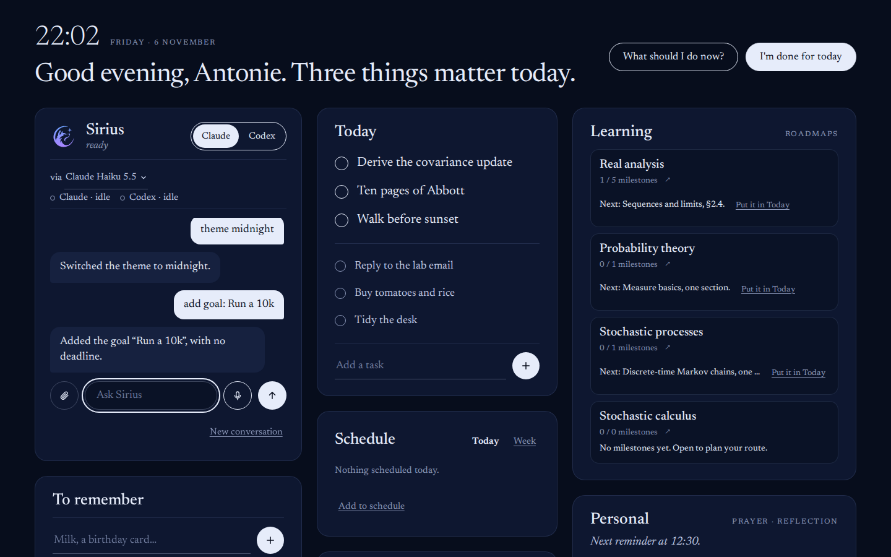
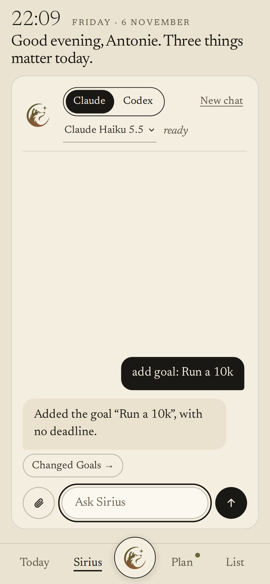
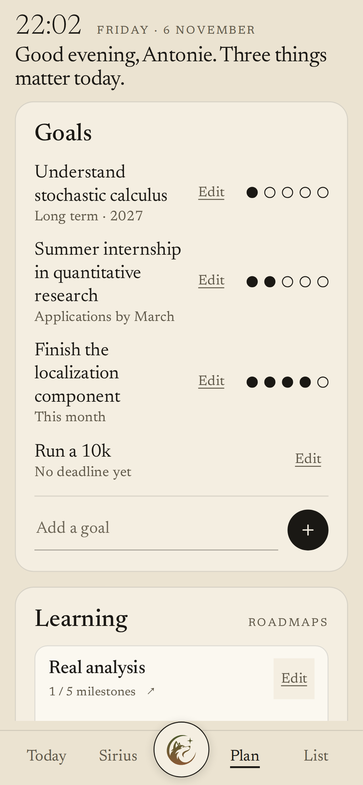

# Sirius

A personal dashboard and assistant for the day, on Ubuntu and Android.

Sirius opens at login on Ubuntu and shows what matters today, a few goals, a learning path,
personal reminders and a short list of things to remember. The assistant in it runs the official
**Claude Code** and **Codex** command-line tools on your own subscriptions. It also tells you
when one of those agents, running elsewhere on the machine, is waiting for you. Speech
recognition and speech synthesis run on the laptop. A paired Android phone shows the same
dashboard over a private Tailscale link, in Chrome or in the Sirius Android app, and keeps
working from its own copy while the laptop is away.

<p align="center">
  
  &nbsp;
  
</p>

## Contents

- [Features](#features)
- [Screens](#screens)
- [How it works](#how-it-works)
- [Requirements](#requirements)
- [Install](#install)
- [Pair a phone](#pair-a-phone)
- [The Android app](#the-android-app)
- [Everyday use](#everyday-use)
- [Configuration](#configuration)
- [Where your data lives](#where-your-data-lives)
- [Privacy and safety](#privacy-and-safety)
- [Development](#development)
- [Status and known limits](#status-and-known-limits)
- [What's next](#whats-next)
- [Documentation](#documentation)

## Features

| Area | What it does |
|---|---|
| **Sirius** | A chat with Claude or Codex, switched with one tap, through the official CLIs. One conversation lasts until you start a new one, and it carries over when you switch agents. Pick the model under the switch: Claude's, or four Codex presets, each with its own reasoning effort. A memory file keeps lasting facts across sessions. |
| **Today** | Two or three priorities plus small tasks. Unfinished tasks move quietly to the next day at 04:00. When only small things are left, the greeting says so: "Something is waiting for you." |
| **Schedule** | Fixed commitments such as lectures, the gym or shifts: weekly on chosen days within a term, or once. Kept apart from tasks, with a reminder 10 minutes before. Sirius can add them for you, and your phone's calendar can show them. |
| **Goals** | A few goals, with milestone dots instead of percentages. "A step closer" marks today as a day you worked on the goal, without adding a milestone. You can add goals by hand or ask Sirius. |
| **Learning** | Independent roadmaps, each with its milestones and its own page of checkpoints, descriptions and progress notes. "Put it in Today" turns the next step into a task; ticking that task logs a day worked on the step and leaves the step open until you finish it. Attach a syllabus PDF or Markdown file in the chat, and Sirius turns it into a roadmap. |
| **To remember** | A plain list for things to buy or remember, with no day or time attached. |
| **Personal and Well-being** | Prayer and reflection reminders, a breathing exercise and stretch nudges. |
| **Agent attention** | A toast and a desktop notification when Claude Code or Codex, in any terminal, is blocked on a permission prompt or a question. It clears itself once you answer. Clicking it brings up the terminal or VS Code the agent runs in, also from a distrobox container; with the focus extension, that agent's own window. The Sirius card shows which sessions are working or idle. |
| **Voice** | Push-to-talk with **Ctrl+Alt+Space**, in English and Romanian. Common commands such as "add milk to my list" or "ce urmează" are handled on the laptop without an agent turn, and anything else goes to the agent. |
| **Looks** | Seven themes, among them Black Night (black with the wolf's blue-to-orange gradient); ask Sirius ("switch to midnight", "something darker"). The Sirius wolf takes each theme's colours and reacts to what happens: it draws itself in at launch, listens, thinks and speaks with the voice, works while an agent runs, howls when one finishes or wants you, and sleeps in quiet mode. |
| **Phone** | An installable web app over Tailscale, with its own layout: Today, Sirius, Plan and List behind a bottom bar, and a mic that sends your voice to the laptop, stops by itself once you go quiet, and says the answer on the phone. It keeps an offline copy, opens from it within about three seconds when the laptop does not answer, queues the changes you make while away, and sends each one exactly once when the laptop is back. |
| **Android app** | The same phone app in a native shell, which adds reminders scheduled on the phone (they fire with the laptop off), agent alerts, home-screen widgets and background sync. No Google account, no Firebase, built locally for free. |

Agents never change several things at once, or delete anything, without you confirming a
proposal card. Single changes an agent makes can be undone for 30 seconds.

## Screens

The desktop in the Midnight theme, after two requests to Sirius; then the phone's Sirius and Plan
tabs. All screenshots use the built-in demo data (`?fixtures`), and
`bun run build:ui && SIRIUS_README_SHOTS=1 bunx playwright test readme-shots` takes them
again.

<p align="center">
  
</p>
<p align="center">
  
  &nbsp;
  
</p>

## How it works

```
 ┌───────────────┐   ┌──────────────────┐   ┌──────────────────┐
 │ Desktop app   │   │ Phone (PWA)      │   │ Claude Code /    │
 │ Tauri + React │   │ over Tailscale   │   │ Codex anywhere   │
 └──────┬────────┘   └───────┬──────────┘   └──────┬───────────┘
        │ REST + SSE         │ HTTPS               │ hooks: sirius notify
        ▼                    ▼                     ▼
 ┌─────────────────────────────────────────────────────────────┐
 │ sirius-core   Bun · Hono · SQLite (WAL) · 127.0.0.1:7337    │
 │ the only writer: ops, scheduler, proposals, undo, memory    │
 └──────┬──────────────────────────────┬───────────────────────┘
        │ spawns, one turn at a time   │ events
        ▼                              ▼
 ┌──────────────────────────┐   ┌───────────────────────────────┐
 │ claude -p / codex exec   │   │ sirius-voice (Python)         │
 │ tools: sirius-mcp only   │   │ Silero VAD · faster-whisper   │
 └──────────────────────────┘   │ Piper TTS · PipeWire          │
                                └───────────────────────────────┘
```

- **One source of truth.** Every operation is declared once in
  `packages/contracts/src/ops.ts`. The REST routes, the OpenAPI document, the typed client and
  the MCP tools are all derived from it.
- **Agents are fenced in.** Both CLIs run with their built-in tools switched off and only the
  `sirius` MCP server available, so they cannot read files, run commands or browse. A canary
  check in `bench/agents.ts` proves this against the real CLIs.
- **The core owns time.** The 04:00 rollover, reminders and backups run in the core, so they keep
  working with the window closed to the tray.
- **All up or all down.** Quitting the app stops the core, and stopping the core closes the app.
  With a phone paired, the laptop keeps serving it instead. See ADR 0009.

## Requirements

- Ubuntu 24.04 with GNOME 46 on Wayland. Other desktops may work, but this is the only one tested.
- [Bun](https://bun.sh) 1.4 or later, and Rust with the
  [Tauri 2 prerequisites](https://v2.tauri.app/start/prerequisites/) for building the desktop app.
- [uv](https://docs.astral.sh/uv/) and Python 3.12 for voice.
- `claude` and/or `codex` installed and logged in.
- Optional: an NVIDIA GPU, which makes speech recognition several times faster. Voice also works
  on the CPU.
- Optional: [Tailscale](https://tailscale.com) on the laptop and phone, for phone access. The
  personal plan is free.

## Install

```bash
git clone <this repository> sirius && cd sirius
scripts/deploy.sh --with-mcp --with-voice --with-desktop
sudo apt install --reinstall ./apps/desktop/src-tauri/target/release/bundle/deb/Sirius_0.1.0_amd64.deb
sirius setup-hooks --apply      # agent alerts; your settings are backed up first
sirius doctor                   # checks every part
```

`setup-hooks` makes Claude Code and Codex tell Sirius when they need you: a permission prompt,
a question or an approval. You then get a banner at the top of the screen and on the phone
instead of checking the terminal, and it clears itself once you answer. Codex asks you to trust
new hooks once: open `/hooks` in Codex and approve the Sirius ones.

Clicking an alert brings up the terminal or VS Code the agent runs in. To raise that agent's
own window rather than the app's latest one, add `--with-focus`: it installs a small GNOME Shell
extension, which GNOME loads after one logout (ADR 0015).

`deploy.sh` reads `deployment.env`, builds everything, and installs the core and voice as
systemd user services. With `--with-mcp` it also registers `sirius-mcp` with Claude Code and
Codex. The voice step downloads about 3 GB of models once.

To update, run the same two install commands again. The `--reinstall` matters: every build is
version 0.1.0, and apt would otherwise skip it. If Sirius is open, restart it with
`pkill -x sirius-desktop`, then open it from the launcher.

## Pair a phone

1. Install Tailscale on the laptop and the phone, and sign in to the same account on both.
2. In the Tailscale admin console, under **DNS**, turn on **MagicDNS** and **HTTPS Certificates**.
3. On the laptop, run `sudo tailscale set --operator=$USER` once.
4. Run `sirius pair`. It sets up `tailscale serve` if needed and prints a link and a six-digit
   code. Install `qrencode` to get a QR code as well.
5. Open the link in Chrome on the phone, then choose **Install app** from Chrome's menu.

The code works once, for five minutes. `sirius forget-phones` signs out every paired phone.
The phone picks up new versions by itself after each install.

For notifications on the phone, tap **Turn on** at the top of Today and allow them. Reminders,
schedule alerts and agent alerts then arrive as ordinary Android notifications, through Chrome,
with no extra app. Each one is encrypted on the laptop for that phone, so the push service in
between cannot read it. They come from the laptop, so it has to be awake.

For the schedule in your phone's own calendar, with its widget and alarms that ring with the
laptop off, run `sirius calendar` and subscribe to the address it prints with
[ICSx⁵](https://icsx5.bitfire.at/), a free, open-source Android app.

## The Android app

Instead of installing the page from Chrome, you can use the Sirius app. Its screen is the same
web phone app, served by the laptop, so a UI change reaches the phone with no new APK. Around
it, the app schedules reminders and schedule alerts on the phone itself, so they ring with the
laptop off, turns agent alerts into notifications, refreshes in the background about every
15 minutes, and adds three home-screen widgets:

- **Sirius: Today**: today's tasks, then the things to remember, in one list that scrolls.
  Tap a task to tick or untick it and an item to tick it off; the tick shows at once and the
  laptop's answer confirms it. Tap the wolf to talk, or the title to open the app without the
  microphone. It uses the theme's colours and fonts.
- **Sirius: Today (small)**: the same, a row shorter. Any Today widget resized to about two
  rows tightens its header so more of the list shows.
- **Sirius: Talk**: just the wolf, one cell and resizable. A tap opens Sirius already listening.

Both open the app through the `sirius://listen` link. The widgets show the laptop's data when it
answers and the last saved copy when it does not, marked "Laptop away"; a tick made while the
laptop is away is put back rather than queued. Home-screen widgets cannot animate, so the wolf
there is still; it moves once the app is open. If the app's page ever goes blank after the phone
has been away, the app reloads it by itself.

```bash
scripts/android-build.sh    # writes releases/sirius-android-<version>.apk
```

The first build downloads JDK 17, the Android SDK and Gradle's dependencies into `.cache/`
(a few GB). Copy the APK to the phone, install it, and pair with `sirius pair` as above, typing
the address and code into the app. The full steps, including the battery setting MagicOS needs,
are in [apps/mobile/README.md](apps/mobile/README.md); the reasoning is in ADR 0013 and 0014.
If browser notifications are on in Chrome too, turn them off there, or reminders arrive twice.

## Everyday use

| | |
|---|---|
| `Ctrl+Alt+Space` | Talk to Sirius. Press again to stop listening, or to interrupt a reply. |
| `sirius doctor` | Check the core, the agents, notifications and voice. |
| `sirius voice on` / `off` | Turn voice on, or off and stop its service. |
| `sirius pair` / `forget-phones` | Pair a phone, or sign all of them out. |
| `sirius calendar` | Print the schedule's calendar feed address, for ICSx⁵ on Android. |
| `sirius backup` | Take a snapshot of the database now. One is also taken every night. |
| `sirius setup-hooks [--apply]` | Show, or apply, the Claude Code and Codex hook changes. |

Some things you can say: "add water the basil to today", "add milk to my list",
"remind me at five to call mum", "what's next", "I'm done for today", "start breathing",
"adaugă cumpără orez la azi", "pune lapte pe listă", "ce urmează".

## Configuration

Everything is in `deployment.env`, a tracked file you edit by hand. After changing it, run
`scripts/deploy.sh` again.

| Setting | Default | Meaning |
|---|---|---|
| `SIRIUS_TARGET` | `local` | `local` keeps everything on this laptop. `remote` runs the core in Docker; see [docs/DEPLOYMENT.md](docs/DEPLOYMENT.md). |
| `SIRIUS_MEMORY_FILE` | inside the Obsidian vault | The Markdown file Sirius remembers in. You can read and edit it. |
| `SIRIUS_VOICE_EN` / `SIRIUS_VOICE_RO` | `en_US-lessac-medium` / `ro_RO-mihai-medium` | Any [Piper voice](https://rhasspy.github.io/piper-samples/) name, or a direct link to a voice's `.onnx` file. |
| `SIRIUS_VOICE_PACE` | `1.0` | Above 1 speaks more slowly. |
| `SIRIUS_NTFY_URL` | empty | An [ntfy](https://ntfy.sh) topic, for agent alerts and reminders on the phone. The public server sees the text, so use a long random topic, or host ntfy yourself. |

Secrets never go in `deployment.env`. The remote setup keeps them in the git-ignored `infra/.env`.

## Where your data lives

| Path | Contents |
|---|---|
| `~/.local/share/sirius/sirius.sqlite` | Everything on the dashboard, plus the chat |
| `~/.local/share/sirius/backups/` | Nightly snapshots |
| `~/.local/share/sirius/token` | The local API token, readable only by you |
| `~/.local/share/sirius/{models,voices,voice-venv}` | Speech models and the voice environment |
| `~/.config/sirius/` | Paths and settings written by the installer |
| `SIRIUS_MEMORY_FILE` | What Sirius remembers about you |

## Privacy and safety

- **Voice stays on the laptop.** Audio is processed in memory and never written to disk.
  The microphone is a process that exists only while you are speaking.
- **No telemetry.** Model downloads happen at install time, and at runtime the voice service runs
  with Hugging Face offline and onnxruntime's telemetry switched off.
- **Agents are contained.** Agents see only the `sirius` tools. They can propose bulk changes and
  deletes, but never apply them without your confirmation, and they are limited to five edits a
  minute.
- **The phone link is private.** The core listens only on `127.0.0.1`, and Tailscale carries it
  to your own devices. A phone holds its own token, stored on the laptop only as a hash.

## Development

```bash
bun install
bun run dev                  # core with live reload, plus the Vite dev server
# then open http://localhost:5173/?fixtures for the UI on built-in demo data, no core needed
```

| Command | Runs |
|---|---|
| `bun run test` | Unit and integration tests for the core, contracts, MCP server and CLI (`bun test`) |
| `bun run test:e2e` | Playwright on desktop, phone, a real local core, a remote-mode core and a paired phone |
| `bun run typecheck` / `bun run lint` | TypeScript 7 strict / Biome |
| `bun run test:mobile` / `bun run typecheck:mobile` | The Android app's notification planner and page bridge / its types |
| `cd services/voice && uv run pytest` | Voice service tests |
| `cd apps/desktop/src-tauri && cargo test` | Desktop shell tests |
| `bun bench/agents.ts` | The real Claude and Codex flows plus the isolation canary. This spends subscription quota. |

```
apps/desktop        Tauri shell and the React app (also served to the phone)
apps/mobile         The Android app: a native shell around the phone page (Expo, own install)
packages/client     Data layer shared by both apps: queries, live updates, offline queue, fixtures
packages/contracts  Op registry, schemas, typed client, 04:00 calendar logic
packages/core       The service: store, ops, scheduler, chat, HTTP, phones
packages/mcp        The stdio MCP server agents use
packages/cli        The `sirius` command
packages/ui         Presentational components and styles
services/voice      Push-to-talk voice service (Python)
infra               systemd units, Docker and compose for remote mode
docs                Requirements, decision records, deployment guide
```

Database changes go through Drizzle: edit `packages/core/src/db/schema.ts`, then run
`bun run db:generate`.

## Status and known limits

v1 covers milestones M0 to M6, plus the phone. It is in daily use on one laptop and one Android
phone. Known limits:

- **Memory:** the desktop app uses about 294 MB against a 200 MB target, because of WebKitGTK.
  ADR 0004 explains why Tauri stays.
- **Android app:** built on the laptop and signed with React Native's debug key, so it installs
  by hand, not from a store. Its screen needs the laptop (or the page's last cached copy);
  agent alerts with the app closed arrive at the next background sync, up to about 15 minutes
  late, unless ntfy is set up. Widget ticks are not queued while the laptop is away. No iPhone
  app yet: it needs the paid Apple Developer Program.
- **Remote mode** (Docker, Cloudflare, ntfy) is built and tested locally, but has never been
  deployed. The container also has no agent CLIs.
- **Wake word:** not built yet; see below.

## What's next

In rough order:

1. **Wake word.** "Hey Sirius" on the laptop, so you can talk without the shortcut (M9 in
   [docs/REQUIREMENTS.md](docs/REQUIREMENTS.md)). Listening for it must stay within the idle
   budget of ADR 0004. It also means a microphone that is always open, so the promise under
   [Privacy and safety](#privacy-and-safety) changes from "only while you speak" to "audio
   stays in memory on the laptop".
2. **Your own voices.** Voices are fixed in `deployment.env` at install. Next: a voice setting
   at runtime, an upload from the app, and the voice service reloading it without a reinstall.
3. **Instant phone alerts with the app closed.** Today they wait for the next background sync.
   A self-hosted ntfy server would make them instant with no Google services and no cost.
4. **iPhone.** The Expo app is written to work on iOS, but installing it needs the Apple
   Developer Program ($99 a year) and a Mac or a cloud build. Not planned until that is worth
   paying for.

## Documentation

- [docs/REQUIREMENTS.md](docs/REQUIREMENTS.md): the full specification and milestones
- [docs/adr/](docs/adr/): decision records, each with its reasoning
- [docs/DEPLOYMENT.md](docs/DEPLOYMENT.md): local or deployed, moving data, restoring backups
- [docs/verified.md](docs/verified.md): vendor facts checked against current tools
- [CHANGELOG.md](CHANGELOG.md): what changed, milestone by milestone
